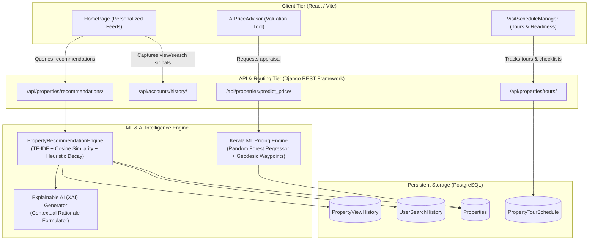
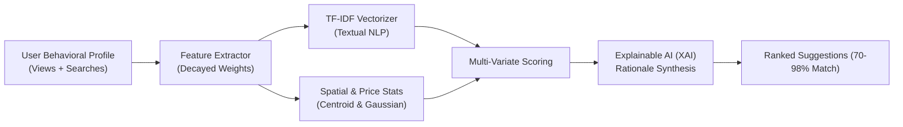
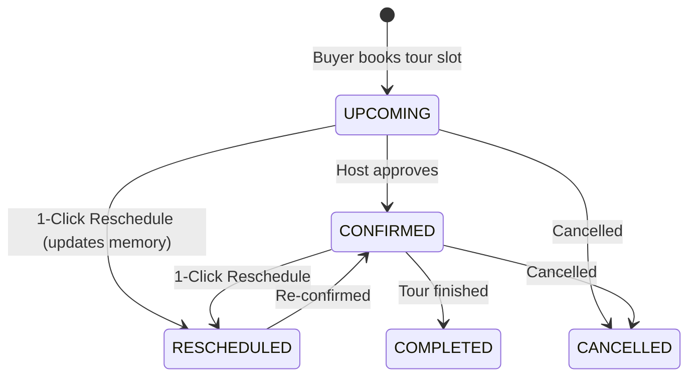

# 🧠 HomeQuest AI & Machine Learning Architecture Documentation

Welcome to the comprehensive technical documentation for the **Artificial Intelligence (AI), Machine Learning (ML), and Predictive Systems** implemented in **HomeQuest**. 

HomeQuest combines modern real estate marketplace mechanics with domain-specific machine learning models calibrated for regional property dynamics, implicit behavioral tracking, natural language processing (NLP), automated valuation models (AVM), and explainable recommendation systems.

---

## 📑 Table of Contents
1. [System Architecture Overview](#-system-architecture-overview)
2. [Implicit Behavioral Tracking (Feedback Loop)](#-1-implicit-behavioral-tracking--feedback-loop)
3. [AI Property Recommendation & Suggestion Engine](#-2-ai-property-recommendation--suggestion-engine)
4. [Kerala Real Estate ML Pricing & Valuation Engine](#-3-kerala-real-estate-ml-pricing--valuation-engine)
5. [AI Express Buyer & Lead Intent Scoring](#-4-ai-express-buyer--lead-intent-scoring)
6. [Automated Legal Sale Agreement Synthesis](#-5-automated-legal-sale-agreement-synthesis)
7. [Smart Visit Schedule Management & Rescheduling](#-6-smart-visit-schedule-management--rescheduling)
8. [API Endpoints Reference](#-7-api-endpoints-reference)
9. [Verification & Testing Guide](#-8-verification--testing-guide)

---

## 🏛 System Architecture Overview



---

## 🔄 1. Implicit Behavioral Tracking & Feedback Loop

Instead of forcing users to fill out tedious preference surveys or click 5-star ratings, HomeQuest implements an **implicit feedback collection architecture**. Behavioral signals are automatically captured in real time once a user authenticates.

### Captured Data Models (`Accounts/models.py`)

#### `PropertyViewHistory`
- **Trigger**: Recorded whenever an authenticated user visits a property details page or expands its full listing card.
- **Attributes**:
  - `user`: Foreign key linking to the authenticated session.
  - `property`: Target property viewed.
  - `view_count`: Frequency counter with atomic increments (`F('view_count') + 1`).
  - `viewed_at`: Timestamp of the latest view.

#### `UserSearchHistory`
- **Trigger**: Captured when a user submits search filters (keywords, target city, property category, price limits, or GPS radius).
- **Attributes**:
  - `query`: Free-form keyword search.
  - `city`: Target municipal area (e.g., *Palakkad*, *Kochi*, *Kozhikode*).
  - `property_type`: Listing category (`APARTMENT`, `RENTAL`, `BUILDING`, `PLOT`).
  - `latitude` / `longitude`: Geolocation coordinates when nearby search is active.
  - `searched_at`: Query execution timestamp.

---

## 🎯 2. AI Property Recommendation & Suggestion Engine

- **File**: `Home_quest/Propertys/recommender_engine.py`
- **Class**: `PropertyRecommendationEngine`
- **Primary Endpoint**: `GET /api/properties/recommendations/`

### Algorithm Pipeline

The recommendation system utilizes a **Hybrid Multi-Criteria Behavioral & Content-Based Vector Model**:



### 1. Mathematical Formulation

#### A. Recency Time-Decay
Interactions fade gradually over time using an exponential half-life curve (calibrated to a 14-day half-life):
$$w_{\text{recency}} = e^{-0.05 \cdot \Delta t}$$
where $\Delta t$ represents days elapsed since the interaction.

#### B. Logarithmic Interaction Scaling
Frequent interactions on a single property indicate strong interest with diminishing returns:
$$w_{\text{interaction}} = \left(1.0 + \ln(\max(1, \text{view\_count}))\right) \cdot w_{\text{recency}}$$

#### C. Continuous Gaussian Price Affection
Rather than a rigid binary cutoff, buyer budget tolerance is modeled using a continuous Gaussian curve around the user's weighted average price $\mu_{\text{price}}$:
$$S_{\text{price}} = e^{-1.5 \cdot \left(\ln\left(\frac{P}{\mu_{\text{price}}}\right)\right)^2}$$

#### D. Great-Circle Geodesic Proximity (Haversine Formula)
When GPS coordinates are present, the spatial distance $d$ between the user's historical centroid and candidate property is computed:
$$d = 2 R \arcsin\left(\sqrt{\sin^2\left(\frac{\Delta \phi}{2}\right) + \cos(\phi_1)\cos(\phi_2)\sin^2\left(\frac{\Delta \lambda}{2}\right)}\right)$$
$$\text{Score}_{\text{dist}} = \max\left(0.1, 1.0 - \frac{d}{60.0}\right)$$

#### E. Natural Language Processing (NLP) with TF-IDF Vectorization
Listing descriptions, titles, and property attributes are converted into sparse n-gram token vectors using Scikit-Learn's `TfidfVectorizer(stop_words='english', max_features=150)`. Cosine similarity measures the textual semantic alignment between the user's interaction corpus and candidate listings:
$$\text{Cosine Sim}(u, p) = \frac{\vec{u} \cdot \vec{p}}{\|\vec{u}\| \|\vec{p}\|}$$

### 2. Multi-Variate Composite Score

Each candidate property is evaluated against the user's composite preference vector:

| Weight | Dimension | Description |
|---|---|---|
| **35%** | **Location Affinity** | Frequency of searched & viewed cities + Haversine distance decay |
| **25%** | **Budget / Price Match** | Gaussian distribution centered on user's viewed price mean |
| **20%** | **Property Type Affinity** | Distribution over `BUILDING`, `APARTMENT`, `RENTAL`, `PLOT` |
| **12%** | **TF-IDF Semantic Match** | Textual similarity of listing description and amenities |
| **8%** | **Space / Area Alignment** | Square footage ratio against user's historical preferences |

> **Novelty & Discoverability**: A discount factor of $0.88\times$ is applied to listings the user has *already viewed*, ensuring the recommendations feed surfaces fresh, unvisited properties while prioritizing top relevancy.

### 3. Explainable AI (XAI) Synthesis
For every recommendation, the engine formulates a clear human-readable rationale:
- *"Matches your frequent searches for rentals in palakkad near your ~₹77,000,000 budget."*
- *"Prime match in Ernakulam closely aligned with your viewed price range."*
- *"Recommended based on your interest in Apartment properties."*

---

## 📈 3. Kerala Real Estate ML Pricing & Valuation Engine

- **Files**: `Home_quest/Propertys/ml_pricing.py` & `Home_quest/frontend/src/AIPriceAdvisor.jsx`
- **Model**: `RandomForestRegressor` via `scikit-learn` Pipeline
- **Primary Endpoint**: `POST /api/properties/predict_price/`

### Regional Geodesic Calibration (Kerala Focus)

Traditional real estate algorithms trained on global or national data fail in Kerala due to unique local factors: dense linear urbanization, high land values, the **NH 66 6-lane widening project**, and proximity to specialized IT corridors.

HomeQuest's Automated Valuation Model (AVM) is explicitly engineered with:

1. **14 District Baseline Calibration**:
   - Tier-1: Ernakulam, Kochi, Kakkanad, Trivandrum, Kozhikode (`₹4,900 - ₹6,800 / sq.ft` baseline).
   - Tier-2: Thrissur, Kottayam, Kollam, Palakkad, Alappuzha, Malappuram, Kannur (`₹3,500 - ₹4,600 / sq.ft`).
   - Tier-3: Kasaragod, Pathanamthitta, Idukki, Wayanad (`₹2,800 - ₹3,200 / sq.ft`).
2. **Infrastructure Corridor Waypoints**:
   - **NH 66 6-Lane Expressway**: 31 geocoded waypoints spanning Parasala to Manjeshwar.
   - **NH 544 (Salem - Kochi 4/6 Lane)**: 10 waypoints through Aluva, Angamaly, Chalakudy, Thrissur, and Palakkad.
   - **MC Road (State Highway 1)**: Waypoints connecting central Travancore.
3. **IT & Tech Park Distance Analysis**:
   - Infopark & SmartCity (Kakkanad, Kochi)
   - Technopark Phase I, II, III (Kazhakkoottam, Trivandrum)
   - Cyberpark (Kozhikode)

### Output Insights Provided by `AIPriceAdvisor`

```json
{
  "suggested_price": 8500000,
  "suggested_price_formatted": "₹85,00,000",
  "fair_range": {
    "min": 7905000,
    "max": 9095000,
    "formatted": "₹79.05 L - ₹90.95 L"
  },
  "rate_per_sqft": 4722,
  "infrastructure_boost": {
    "nh66_distance_km": 2.4,
    "nh66_boost_percent": "+18%",
    "it_park_proximity_km": 4.1,
    "it_park_boost_percent": "+12%"
  },
  "comparative_analysis": "Priced 5.2% below fair market value — High probability of rapid sale."
}
```

---

## ⚡ 4. AI Express Buyer & Lead Intent Scoring

- **Files**: `Home_quest/Propertys/views.py`, `OwnerDashboard.jsx`
- Identifies and flags high-intent buyers submitting enquiries through the automated interest flows.
- Enquiries triggered via personalized recommendation recommendations receive an automated metadata badge:
  - Tag: **`✨ AI Express Buyer`**
  - Allows property owners to filter and prioritize buyers whose budget and historical view records closely match the property.

---

## 📜 5. Automated Legal Sale Agreement Synthesis

- **File**: `Home_quest/Propertys/agreement_generator.py`
- Generates legally structured property sale agreements compliant with the **Indian Registration Act, 1908** and the **Kerala Stamp Act**.
- Automatically injects:
  - Full party identities (buyer name, seller name, PAN/Aadhaar references).
  - Exact schedule of property (Survey numbers, boundaries North/South/East/West, city, village, pin code).
  - Agreed consideration amount, advance earnest deposit, and statutory payment completion windows.
  - Title encumbrance warranties and default indemnification clauses.

---

## 📅 6. Smart Visit Schedule Management & Rescheduling

- **Files**: `Propertys/models.py`, `VisitScheduleManager.jsx`, `ScheduleVisitModal.jsx`
- **Endpoints**: `POST /api/properties/tours/`, `POST /api/properties/tours/{id}/reschedule/`, `PATCH /api/properties/tours/{id}/checklist/`



### Key Technical Capabilities:
1. **Full Reschedule Audit Trail**: Tracks previous appointment slots (`previous_date`, `previous_time_slot`), incrementing `rescheduled_count` and storing revision reasons.
2. **Interactive Role-Aware Checklists (JSONB)**:
   - **Buyer Checklist**: Photo ID, Proof of Funds, Question List, Tape/Notebook, Neighborhood Inspection.
   - **Host Checklist**: Cleaning & Decluttering, Full Lighting, Ventilation, Valuables Secured, Documentation Ready.
   - Interactive completion percentage meter updated dynamically via REST API.
3. **One-Click Calendar Integration**: Generates pre-formatted Google Calendar import URLs with venue coordinates and appointment notes.

---

## 🌐 7. API Endpoints Reference

| Method | Endpoint | Description | Auth Required |
|---|---|---|---|
| `GET` | `/api/properties/recommendations/?limit=6` | Fetches personalized ML property suggestions with XAI match reasons | Optional (Falls back to cold-start for guests) |
| `POST` | `/api/properties/predict_price/` | Runs Random Forest valuation for specified area, type, and coordinates | No |
| `POST` | `/api/accounts/history/view/` | Records property view interaction | Yes |
| `POST` | `/api/accounts/history/search/` | Records location/filter search parameters | Yes |
| `GET` | `/api/properties/tours/` | Retrieves tours filtered by role (`visitor` or `host`) and status | Yes |
| `POST` | `/api/properties/tours/` | Books a new property visit | Yes |
| `POST` | `/api/properties/tours/{id}/reschedule/` | Performs 1-click tour rescheduling | Yes |
| `POST` | `/api/properties/tours/{id}/update_status/` | Transitions tour status (`CONFIRMED`, `COMPLETED`, `CANCELLED`) | Yes |
| `PATCH` | `/api/properties/tours/{id}/checklist/` | Updates buyer or host readiness checklist items | Yes |

---

## 🧪 8. Verification & Testing Guide

### A. Testing the Recommendation Engine via Shell

Run this command inside the `Home_quest` root:

```powershell
python -c "import sys, django, os; os.environ.setdefault('DJANGO_SETTINGS_MODULE', 'myproject.settings'); django.setup(); from Propertys.recommender_engine import PropertyRecommendationEngine; from Accounts.models import User; u = User.objects.first(); [print('🎯', r.title, '|', r.match_score, '|', r.ai_reason) for r in PropertyRecommendationEngine.get_recommendations_for_user(u)]"
```

**Expected Sample Output:**
```text
🎯 Abbas_villa | 88% Match | Matches your frequent searches for rentals in palakkad near your ~₹77,000,000 budget.
🎯 modern willa | 68% Match | Located in palakkad, matching your recent location searches.
```

### B. Testing Real Estate ML Price Prediction via Python Shell

```powershell
python -c "import django, os; os.environ.setdefault('DJANGO_SETTINGS_MODULE', 'myproject.settings'); django.setup(); from Propertys.ml_pricing import predict_and_analyze_property; res = predict_and_analyze_property('Kakkanad', 'BUILDING', 1800, 10.0159, 76.3419, 7500000); print('Valuation:', res['suggested_price_formatted']); print('Rate/Sqft:', res['rate_per_sqft'])"
```

### C. Testing Frontend Compilation

```powershell
npm --prefix "frontend" run build
```
Ensures all JSX components (`ScheduleVisitModal`, `VisitScheduleManager`, `AIPriceAdvisor`, `HomePage`) compile without bundling errors.
