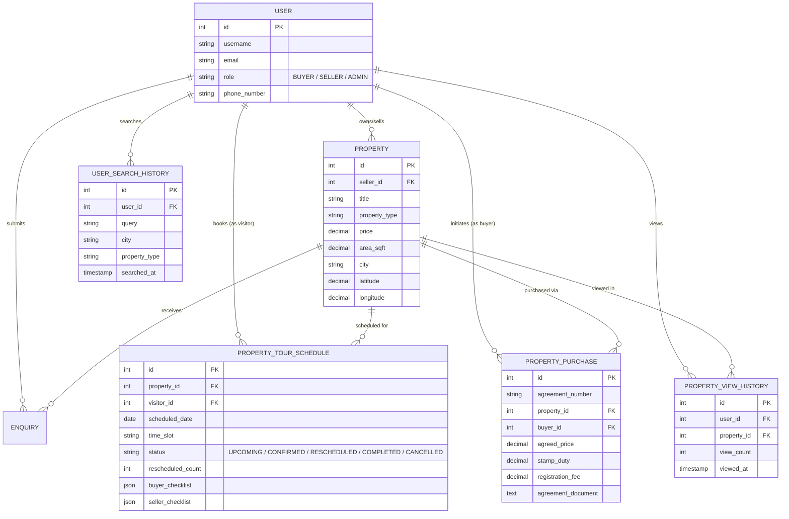

# 🏠 HomeQuest — Comprehensive Master Project Documentation

**Direct-Owner Real Estate Marketplace with AI/ML Recommendations, Automated Valuation, Tour Scheduling, and Legal Document Synthesis**

---

## 📌 Executive Summary

**HomeQuest** is a modern, full-stack real estate marketplace engineered to eliminate traditional broker intermediaries, reduce spam, and automate the entire property discovery-to-ownership workflow. 

By combining **Django REST Framework (DRF)** on the backend, **React & Vite** on the frontend, and specialized **Scikit-Learn Machine Learning Models**, HomeQuest provides verified direct-owner listings, privacy-safe OTP authentication, GPS proximity mapping, explainable AI recommendations, automated Kerala property market valuation, 1-click visit scheduling with readiness checklists, and statutory legal sale agreement synthesis.

---

## 🏛 System Architecture Overview

```mermaid
flowchart TB
    subgraph Client ["Client Tier (React 18 + Vite)"]
        UI_Home["HomePage (Listings, Maps & Recs)"]
        UI_Search["Search Bar & History Dropdown"]
        UI_Dashboard["Owner Dashboard (Listings & Enquiries)"]
        UI_Advisor["AI Price & Area Increment Advisor"]
        UI_Tours["Visit Schedule & Tour Manager"]
        UI_Deed["Property Buy & Sale Deed Modal"]
        UI_HistoryModal["Search & Activity History Modal"]
    end

    subgraph API ["REST API Layer (Django REST Framework)"]
        API_Auth["/api/auth/* (OTP, JWT, History)"]
        API_Props["/api/properties/* (CRUD, Proximity)"]
        API_Recs["/api/properties/recommendations/"]
        API_Val["/api/properties/predict_price/"]
        API_Tours["/api/properties/tours/*"]
        API_Purchases["/api/properties/purchases/*"]
    end

    subgraph Intelligence ["Machine Learning & Intelligence Suite"]
        ML_Recs["PropertyRecommendationEngine\n(TF-IDF + Cosine Similarity + Time Decay)"]
        ML_Val["Kerala Real Estate Pricing Engine\n(Random Forest Regressor + Geodesics)"]
        ML_XAI["Explainable AI (XAI) Synthesis"]
        Engine_Deed["Automated Legal Sale Deed Generator"]
    end

    subgraph Storage ["Database & Storage Tier (PostgreSQL)"]
        DB_Users[("User & OTP Models")]
        DB_History[("PropertyViewHistory & UserSearchHistory")]
        DB_Properties[("Property Listings & Media")]
        DB_Tours[("PropertyTourSchedule")]
        DB_Purchases[("PropertyPurchase Records")]
    end

    Client -->|JWT Bearer / REST JSON| API
    API --> Intelligence
    API --> Storage
    Intelligence --> Storage
```



---

## 🌟 The Main Core Features (What Was Built)

### 1. 🔐 Security & OTP-Based Authentication
- **Secure Email OTP Onboarding**: Users register and verify identities via 6-digit cryptographic email OTPs (`PendingRegistration`, `PasswordResetOTP`).
- **Role-Based Access Control (RBAC)**:
  - **Buyers/Visitors**: Browse listings, search with geolocation, schedule tours, generate legal sale agreements, and track personal search history.
  - **Property Owners / Sellers**: Dedicated suite to list properties, manage inquiries, evaluate market valuation with AI, and track visitor tour schedules.
  - **Administrators**: System-wide oversight.
- **JWT Token Management**: Secure token persistence (`access_token`, `refresh_token`) with silent authentication checks on the frontend.

---

### 2. 🔍 Smart Search, Geolocation & Search History System
- **Interactive Leaflet Proximity Map**: Visualizes properties across Kerala with dynamic pins and details popups.
- **"Near Me" GPS Geolocation**: Computes great-circle distance (Haversine formula) in kilometers from user's current GPS coordinates or selected landmark.
- **Interactive Search History Dropdown**:
  - Attached directly to the navbar search bar.
  - Displays recent searches with location badges, property type filters, and result counts.
  - **1-Click Execution**: Instantly populates search fields and filters listings.
  - **Single Item Removal (`✕`)**: Delete specific past queries without wiping entire history.
  - **Trending / Popular Shortcuts**: Quick-filter pills for top locations (`Kochi`, `Palakkad`, `Trivandrum`, etc.).
- **Dedicated Activity & Search History Modal (`SearchHistoryModal.jsx`)**:
  - Accessible via **`🕒 Search History`** in the navbar.
  - **Search History Tab**: Complete chronological audit of past searches, relative timestamps (`10m ago`, `2h ago`), result counts, and **⚡ Search Again** action.
  - **Viewed Properties Tab**: Visual gallery of browsed properties with view counters and individual delete controls.
  - Summary stats: *Total Searches*, *Top Location*, *Total Properties Viewed*.

---

### 3. 🧠 Machine Learning & AI Intelligence Suite

#### A. AI Property Recommendation Engine (`Propertys/recommender_engine.py`)
- **Implicit Behavioral Tracking**: Collects user view history (`PropertyViewHistory`) and search history (`UserSearchHistory`) in real time once authenticated.
- **Hybrid Multi-Factor Recommendation Pipeline**:
  1. **Recency Time-Decay**: Exponential half-life weighting ($w_{\text{recency}} = e^{-0.05 \cdot \Delta t}$, 14-day half-life).
  2. **Logarithmic Interaction Scaling**: $w_{\text{interaction}} = (1 + \ln(\text{count})) \cdot w_{\text{recency}}$.
  3. **Gaussian Budget Matching**: Models buyer budget tolerance with a continuous curve centered around the user's viewed price mean.
  4. **NLP & TF-IDF Cosine Similarity**: Scikit-Learn `TfidfVectorizer` transforms descriptions and amenities into sparse n-gram token vectors to measure semantic alignment.
  5. **Composite Scoring Weights**:
     - **Location Affinity (35%)**
     - **Budget / Price Match (25%)**
     - **Property Type Preference (20%)**
     - **TF-IDF Semantic Description Match (12%)**
     - **Area / Space Alignment (8%)**
  6. **Explainable AI (XAI)**: Generates human-readable explanation badges (e.g., *"Matches your frequent searches for rentals in palakkad near your ~₹77,000,000 budget."*).
  7. **Cold-Start Handling**: Provides intelligent trending suggestions for guests and new users.

#### B. Kerala Real Estate ML Pricing & Valuation Engine (`Propertys/ml_pricing.py`)
- **Random Forest Regressor** trained and calibrated specifically for Kerala's regional real estate market dynamics.
- **Geodesic Infrastructure Feature Engineering**:
  - **14 District Baselines**: Tier-1 (Ernakulam, Kochi, Trivandrum, Kozhikode), Tier-2 (Thrissur, Palakkad, Kottayam, etc.), and Tier-3 (Wayanad, Idukki, Kasaragod).
  - **NH 66 6-Lane Expressway Expansion Corridor**: 31 geocoded waypoints spanning Parasala to Manjeshwar.
  - **NH 544 & MC Road Highway Waypoints**: Measures distance to major transit arteries.
  - **Major IT Corridors**: Measures proximity to Infopark Kakkanad, Technopark Kazhakkoottam, and Cyberpark Kozhikode.
- **Interactive UI (`AIPriceAdvisor.jsx`)**:
  - Suggests fair market valuations, rate per sq.ft., and estimated price bands.
  - Computes infrastructure boost percentages (e.g., *+18% NH 66 Corridor proximity boost*).
  - "1-Click Apply AI Valuation" automatically updates the property listing price.

#### C. AI Express Buyer & Lead Scoring
- Identifies and prioritizes high-intent buyer inquiries initiated from recommendation ribbons with a **`✨ AI Express Buyer`** badge, allowing property owners to triage inquiries effectively.

---

### 4. 📅 Smart Visit Schedule Management & Rescheduling
- **Dedicated Visit Calendar (`VisitScheduleManager.jsx`)**:
  - Status tabs: **Upcoming**, **Rescheduled**, **Completed**, and **Cancelled**.
  - Dual perspective: **Visitor View** (for buyers) and **Host View** (for owners managing site visits on their listings).
- **One-Click Rescheduling**:
  - Modal with instant date & time slot selection.
  - **Audit Memory**: Retains previous appointment history (`previous_date`, `previous_time_slot`, `rescheduled_count`) with recorded revision reasons.
- **Interactive Readiness Checklists (JSONB)**:
  - **Visitor Checklist**: *Photo ID ready*, *Proof of funds / pre-approval*, *Questions list*, *Measurement tape / notebook*, *Neighborhood & parking inspection*.
  - **Host Checklist**: *Cleaned & decluttered*, *All lights turned on*, *Ventilation & fragrance*, *Valuables & pets secured*, *Property documents ready*.
  - Real-time percentage progress bar updated via `PATCH /api/properties/tours/{id}/checklist/`.
- **Google Calendar Export**: One-click direct link to add confirmed tours to Google Calendar with address and appointment details.

---

### 5. 📜 Automated Legal Sale Agreement Deed Generator
- **Engine**: `Propertys/agreement_generator.py`
- **Statutory Compliance**: Synthesizes verified legal documents compliant with the **Indian Registration Act, 1908** and the **Kerala Stamp Act**.
- **Calculations Included**:
  - Base Property Price.
  - Kerala Stamp Duty (8%).
  - Sub-Registrar Office Registration Fee (2%).
  - Total Estimated Consideration Outlay.
- **Deed Generation Flow (`PropertyBuyModal.jsx`)**:
  - Auto-identifies authenticated buyer and seller details.
  - Injects full property schedule, boundaries (North, South, East, West), survey numbers, and statutory settlement windows (60 days).
  - In-app document viewer with **🖨️ Print / Save PDF** capability.

---

### 6. 🏢 Owner Dashboard Suite (`OwnerDashboard.jsx`)
- **Listing Management**: Real-time CRUD operations, image uploads, price updates, and area specifications.
- **Enquiry Management**: Direct inbox for buyer communications with status transitions (`PENDING`, `CONTACTED`, `RESOLVED`).
- **Tours & Visits Tab**: Dedicated view for hosts to inspect incoming site visits, track buyer checklists, and approve reschedule requests.

---

## 🗄 Database Models Architecture



---

## 🌐 API Reference Matrix

| Category | Method | Endpoint | Description |
|---|---|---|---|
| **Authentication** | `POST` | `/api/auth/register/` | Initiates registration & sends OTP |
| | `POST` | `/api/auth/verify-email/` | Verifies OTP & activates account |
| | `POST` | `/api/auth/login/` | Authenticates user & issues JWT pair |
| **User History** | `GET` | `/api/auth/history/` | Returns recent searches & viewed properties |
| | `POST` | `/api/auth/history/view/` | Records property view interaction |
| | `POST` | `/api/auth/history/search/` | Records location/filter search query |
| | `DELETE`| `/api/auth/history/` | Clears search/view history or deletes item by `id` |
| **Properties** | `GET` | `/api/properties/` | Lists properties with filter/proximity support |
| | `POST` | `/api/properties/` | Creates a new property listing (Owner only) |
| | `GET` | `/api/properties/nearby/` | Proximity search by `lat`, `lng`, and `radius` |
| **AI / ML** | `GET` | `/api/properties/recommendations/` | Hybrid ML property suggestions with XAI reasons |
| | `POST` | `/api/properties/predict_price/` | Random Forest market valuation & infrastructure boost |
| **Tours / Visits** | `GET` | `/api/properties/tours/` | Lists tours filtered by role (`visitor`/`host`) and status |
| | `POST` | `/api/properties/tours/` | Schedules a new in-person site visit |
| | `POST` | `/api/properties/tours/{id}/reschedule/` | 1-Click tour rescheduling with audit tracking |
| | `POST` | `/api/properties/tours/{id}/update_status/` | Transitions status (`CONFIRMED`, `COMPLETED`, `CANCELLED`) |
| | `PATCH`| `/api/properties/tours/{id}/checklist/` | Toggles buyer or seller readiness checklist items |
| **Purchases** | `POST` | `/api/properties/purchases/` | Generates official Kerala Real Estate Sale Agreement |
| | `GET` | `/api/properties/purchases/{id}/` | Retrieves generated legal deed document |

---

## 💻 Tech Stack & Dependencies

### Backend
- **Python**: 3.14 / 3.11+
- **Django**: 5.x Web Framework
- **Django REST Framework (DRF)**: RESTful API architecture
- **djangorestframework-simplejwt**: JWT authentication
- **scikit-learn**: Machine learning (Random Forest, TF-IDF vectorization, Cosine Similarity)
- **numpy & pandas**: Numerical operations and tabular processing
- **joblib**: Model serialization
- **PostgreSQL**: Relational database engine

### Frontend
- **React**: 18.x UI Component Library
- **Vite**: Ultra-fast build tool and development server
- **Leaflet & React-Leaflet**: Interactive map rendering & geolocation
- **Axios**: HTTP client with automatic JWT token attachment
- **Modern CSS3**: Responsive styling with flexbox, grid, and CSS variables

---

## 🛠 Setup, Installation & Verification Guide

### 1. Prerequisites
- Python 3.10+ installed
- Node.js 18+ and npm installed
- PostgreSQL database server running on `localhost:5432`

### 2. Backend Setup
```powershell
# Navigate into the project directory
cd Home_quest

# Create & activate Python virtual environment
python -m venv .venv
.\.venv\Scripts\Activate.ps1

# Install Python requirements
pip install -r requirements.txt

# Apply database migrations
python manage.py migrate

# Validate system checks
python manage.py check

# Start Django development server
python manage.py runserver 8000
```

### 3. Frontend Setup
```powershell
# Navigate into the frontend folder
cd Home_quest/frontend

# Install dependencies
npm install

# Run the development server
npm run dev

# Or build for production
npm run build
```

### 4. CLI Verification Commands

#### Verify the AI Recommendation Engine:
```powershell
python -c "import sys, django, os; os.environ.setdefault('DJANGO_SETTINGS_MODULE', 'myproject.settings'); django.setup(); from Propertys.recommender_engine import PropertyRecommendationEngine; from Accounts.models import User; u = User.objects.first(); [print('🎯', r.title, '|', r.match_score, '|', r.ai_reason) for r in PropertyRecommendationEngine.get_recommendations_for_user(u)]"
```

#### Verify the Kerala ML Real Estate Pricing Engine:
```powershell
python -c "import django, os; os.environ.setdefault('DJANGO_SETTINGS_MODULE', 'myproject.settings'); django.setup(); from Propertys.ml_pricing import predict_and_analyze_property; res = predict_and_analyze_property('Kakkanad', 'BUILDING', 1800, 10.0159, 76.3419, 7500000); print('Suggested Valuation:', res['suggested_price_formatted']); print('Rate/Sqft:', res['rate_per_sqft'])"
```

---

## 📂 Project Structure Map

```text
Home_quest/
├── Accounts/                       # Authentication, OTP, & User Behavioral Models
│   ├── models.py                   # User, PendingRegistration, PropertyViewHistory, UserSearchHistory
│   ├── views.py                    # Register, VerifyOTP, Login, UserHistoryAPI
│   ├── serializers.py              # User and history serializers
│   └── urls.py                     # Auth and history routing
├── Propertys/                      # Core Real Estate Marketplace & ML Engines
│   ├── models.py                   # Property, Enquiry, PropertyPurchase, PropertyTourSchedule
│   ├── views.py                    # PropertyViewSet, EnquiryViewSet, TourScheduleViewSet
│   ├── serializers.py              # Serialization with financial & checklist metadata
│   ├── recommender_engine.py       # Hybrid TF-IDF + Gaussian + Time-Decay Recommendation Model
│   ├── ml_pricing.py               # Random Forest Regressor & Geodesic Highway Engine
│   ├── agreement_generator.py      # Kerala Stamp Act Legal Document Synthesis
│   └── urls.py                     # Property, valuation, purchase, and tour routes
├── frontend/                       # React 18 + Vite Frontend Application
│   ├── src/
│   │   ├── HomePage.jsx            # Main marketplace, search bar, map, recommendations
│   │   ├── HomePage.css            # Marketplace styles & history dropdown
│   │   ├── SearchHistoryModal.jsx  # Activity & Search History Manager
│   │   ├── SearchHistoryModal.css  # Search history modal styles
│   │   ├── ScheduleVisitModal.jsx  # In-person tour appointment booking dialog
│   │   ├── VisitScheduleManager.jsx# Dedicated visit calendar & checklist tracker
│   │   ├── PropertyBuyModal.jsx    # Purchase deed generator dialog
│   │   ├── AIPriceAdvisor.jsx      # Owner real-time valuation & boost calculator
│   │   ├── OwnerDashboard.jsx      # Owner property & inquiry management suite
│   │   ├── LocationMap.jsx         # Interactive Leaflet map view
│   │   └── api.js                  # Axios client, authAPI, propertyAPI, tourAPI, historyAPI
│   ├── package.json                # Frontend package configuration
│   └── vite.config.js              # Vite bundling configuration
├── myproject/                      # Django project configuration (settings, root urls)
├── manage.py                       # Django CLI manager
├── requirements.txt                # Python dependencies
├── PROJECT_DOCUMENTATION.md        # Master technical documentation (this file)
└── AI_ML_DOCUMENTATION.md          # Dedicated AI & Machine Learning deep-dive documentation
```

---

## 👥 Contributors & Maintainers
- Developed for **HomeQuest** Real Estate & Living Ecosystem.
- All code formatted, validated with zero check errors, and maintained on `origin main`.
