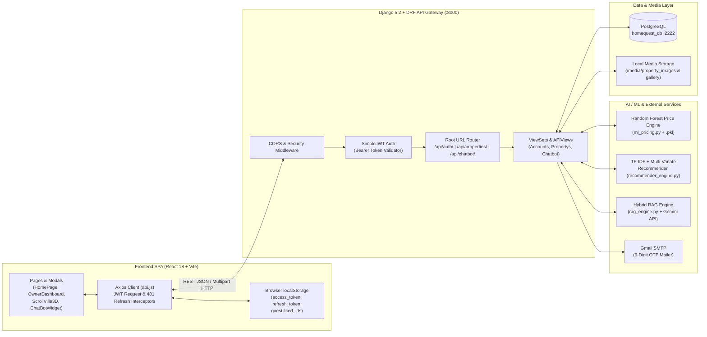
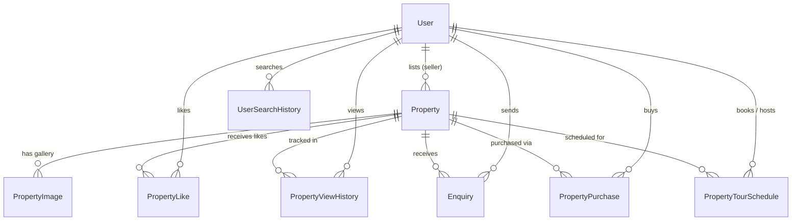
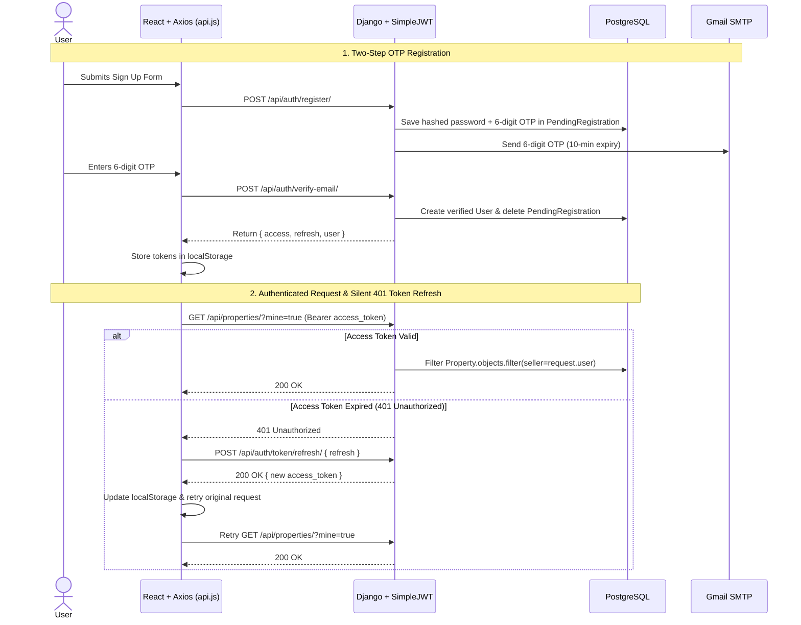

# HomeQuest AI — Complete Technical & Architectural Documentation

This documentation reflects the live codebase of **HomeQuest AI**, an intelligent full-stack real estate marketplace engineered specifically for **Kerala's 14 districts**, combining **Django REST Framework**, **React + Vite**, **PostgreSQL**, **JWT Authentication**, **Scikit-Learn Machine Learning**, **Hybrid RAG + Google Gemini AI**, **Leaflet GIS**, and **Three.js WebGL 3D Visualization**.

---

## 1. Why This Project? (Problem Statement & Vision)

Traditional real estate portals suffer from five structural gaps—especially in fast-developing regional markets like Kerala:

1. **Opaque & Inflated Broker Pricing:** Property sellers and buyers have no objective, data-backed way to price homes or plots relative to local infrastructure booms (such as the **NH 66 6-lane expansion**, **NH 544**, **MC Road**, or proximity to **Infopark, Technopark, and Cyberpark**).
2. **Broker Middlemen & Data Leakage:** Owners need a dedicated, strictly isolated portfolio workspace where their listings, leads, and site-visit calendars connect directly with verified buyers without third-party distortion.
3. **Static, Generic Property Discovery:** Standard filter bars fail to learn from what a user likes, views, or searches—forcing buyers to manually sift through irrelevant listings (e.g., showing apartments to someone looking for freehold plots).
4. **Disconnected Legal & Tour Workflows:** Buying property involves fragmented phone calls, unorganized site visits, and manual calculation of **Kerala Stamp Duty (8%)** and **Registration Fees (2%)**.
5. **Unassisted User Journey:** First-time buyers and sellers struggle to write persuasive inquiries, locate nearby plots by GPS, or understand valuation factors.

### How HomeQuest AI Solves This
**HomeQuest AI** unifies the entire property lifecycle into one intelligent platform:
- **ML Valuation Engine:** Instant fair-market valuation in Indian notation (`₹ Lakhs` / `₹ Crores`) with explainable infrastructure appreciation breakdowns.
- **Personalized ML Recommender:** Real-time content-based recommendations that dynamically adapt the moment a user likes, views, or searches a listing.
- **Hybrid RAG AI Assistant (`QuestBot`):** Conversational search over live database listings + platform guidance + one-click AI Express Interest drafting.
- **Direct Owner Command Center:** Strict account-isolated portfolio management, gallery curation, lead status tracking, interactive tour checklists, and automated Kerala Sale Agreement generation.
- **Interactive 3D & GIS Experience:** Pure-white scroll-driven 3D architectural villa landing experience (Three.js) paired with live GPS "Near Me" discovery (Leaflet + Haversine).

---

## 2. Technology Stack Overview

### Frontend Layer
| Technology | Version | Purpose in HomeQuest AI |
| :--- | :--- | :--- |
| **React** | `18.3.1` | Component-based SPA UI, hooks-driven reactive state, role-based dashboards |
| **Vite** | `5.4.11` | Ultra-fast ES module dev server (HMR) and optimized production bundler |
| **Axios** | `1.7.9` | HTTP client with request/response JWT interceptors & silent token auto-refresh |
| **Three.js** | `0.187.0` | Scroll-driven 3D WebGL architectural villa showcase (`RoomEnvironment` IBL, `RoundedBoxGeometry`, procedural PBR Canvas textures) |
| **Leaflet** | `1.9.4` | Interactive GIS maps, GPS coordinate picker, pinpointed property locations & radius search |
| **Custom CSS3** | Modern CSS | Editorial warm oatmeal & burgundy theme (`Playfair Display` + `Plus Jakarta Sans`), responsive layouts |

### Backend & Database Layer
| Technology | Version | Purpose in HomeQuest AI |
| :--- | :--- | :--- |
| **Django** | `5.2.15` | Core Python web framework, ORM, custom user model, migrations, admin, media handling |
| **Django REST Framework (DRF)** | `3.18.3` | RESTful `ModelViewSet`s, `APIView`s, custom `@action` endpoints, serialization & permissions |
| **SimpleJWT** | `5.5.1` | Stateless JWT authentication (`Access` + `Refresh` token issuance, rotation & blacklisting) |
| **django-cors-headers** | Active | Cross-Origin Resource Sharing between Vite frontend (`:5173`) and Django API (`:8000`) |
| **PostgreSQL** | Port `2222` | Primary relational database (`homequest_db`) storing users, listings, likes, enquiries, tours & agreements |
| **SQLite (`:memory:`)** | Built-in | Automated high-speed isolated test database activated automatically during `manage.py test` |
| **Gmail SMTP (TLS)** | Port `587` | Real-time 6-digit OTP email delivery for account registration & password recovery |

### AI & Machine Learning Layer
| Technology | Version | Purpose in HomeQuest AI |
| :--- | :--- | :--- |
| **Scikit-Learn** | `1.9.1` | `RandomForestRegressor`, `OneHotEncoder`, `ColumnTransformer`, `Pipeline`, `TfidfVectorizer`, `cosine_similarity` |
| **Pandas** | `2.2.2` | Tabular feature construction, dataset synthesis (`kerala_real_estate_data.csv`), inference DataFrames |
| **NumPy** | `2.4.6` | Vectorized numeric computation and similarity scoring |
| **Joblib** | `1.5.3` | Serializing and singleton-caching the trained ML valuation pipeline (`kerala_price_model.pkl`) |
| **Google Gemini API** | `v1beta` | Generative LLM (`gemini-2.5-flash` / fallback chain) for Hybrid RAG responses & AI Inquiry drafting |

---

## 3. How the Full Stack Works Together

### Request-to-Response Execution Lifecycle
1. **User Action (React):** A user triggers an interaction (liking a property, clicking **Analyze Price with AI**, or opening the **Owner Dashboard**).
2. **API Interception (`frontend/src/api.js`):** Axios intercepts the request, reads `access_token` from `localStorage`, and injects `Authorization: Bearer <token>`.
3. **Middleware & Routing (`myproject/settings.py`, `myproject/urls.py`):** Django validates CORS headers, authenticates the JWT signature via `JWTAuthentication`, attaches `request.user`, and routes to `Accounts`, `Propertys`, or `Chatbot`.
4. **Business Logic / ML / ORM:**
   - Standard CRUD operations execute via Django ORM against PostgreSQL (`homequest_db`).
   - Valuation requests invoke `predict_and_analyze_property()` (Haversine distances + `RandomForestRegressor`).
   - Recommendations invoke `PropertyRecommendationEngine.get_recommendations_for_user()` (TF-IDF + multi-variate scoring).
   - Chat requests invoke `rag_engine.query()` (Intent classification + TF-IDF doc search / ORM listing search + Gemini LLM).
5. **Serialization & UI Update:** DRF returns clean JSON; React updates state optimistically and re-renders cards, charts, maps, or modals smoothly.

---

## 4. Detailed Module Breakdown

### 4.1 Backend Modules (Django Apps)

#### Module 1: `myproject` (Core Configuration & Routing)
- `myproject/settings.py`: Automatic `.env` loader, PostgreSQL connection (`localhost:2222`), automatic in-memory SQLite override during `manage.py test`, `AUTH_USER_MODEL = 'Accounts.User'`, custom `EmailOrUsernameBackend`, SimpleJWT parameters, Gmail SMTP config, CORS/CSRF trust list, and `GEMINI_API_KEY` loading.
- `myproject/urls.py`: Mounts `/admin/`, `/api/auth/`, `/api/properties/`, `/api/chatbot/`, and `/media/` file serving.
- `myproject/__init__.py`: Safe Windows (`nt`) patch for Django's `TemporaryFile.close()` destructor during multipart image uploads.

#### Module 2: `Accounts` (Identity, Roles, OTP Verification & Behavioral Tracking)
- **Models (`Accounts/models.py`):**
  - `User` (extends `AbstractUser`): Unique `email`, `phone_number`, `role` (`ADMIN`, `AGENT`, `BUYER`, `SELLER`), `profile_picture`, `bio`, `address`, `city`, `is_verified`.
  - `PendingRegistration`: Temporary staging table storing pre-hashed passwords and 6-digit OTPs (10-minute expiry). A `User` record is created **only after valid OTP submission**.
  - `PasswordResetOTP`: 10-minute 6-digit password recovery tokens indexed by email.
  - `PropertyViewHistory`: Tracks unique `(user, property)` view counts and `viewed_at` timestamps for recency-weighted ML recommendations.
  - `UserSearchHistory`: Logs user search queries, cities, property types, and GPS coordinates (capped at 30 recent rows per user).
- **Custom Auth Backend (`Accounts/backends.py`):** `EmailOrUsernameBackend` enables case-insensitive login with **either username or email**.
- **Views (`Accounts/views.py`):** Registration, OTP verification/resend, forgot/reset password, profile CRUD, and JWT-protected browsing/search history endpoints.

#### Module 3: `Propertys` (Listings, Gallery, Likes, GIS, Enquiries, Purchases, Tours & ML)
- **Models (`Propertys/models.py`):**
  - `Property`: Owned by `seller` (`ForeignKey(User)`), supporting 5 types (`BUILDING`, `PLOT`, `RENTAL`, `APARTMENT`, `REAL_ESTATE`), detailed residential/commercial attributes (`sub_type`, `bhk`, `bathrooms`, `furnishing`, `project_status`, `carpet_area`, `maintenance_monthly`, `total_floors`, `floor_no`, `car_parking`, `facing`, `project_name`), cover `image`, and Leaflet GPS coordinates (`latitude`, `longitude`).
  - `PropertyImage`: Multi-photo gallery (`property_gallery/`) with per-photo captions.
  - `PropertyLike`: Unique `(user, property)` likes table driving wishlists and high-priority AI recommendations.
  - `Enquiry`: Buyer inquiries (`PENDING`, `CONTACTED`, `RESOLVED`) strictly scoped to the property's owner.
  - `PropertyPurchase`: Full booking & legal Sale Agreement generator with unique `agreement_number`, payment methods (`UPI`, `NET_BANKING`, `CARD`, `DEMAND_DRAFT`, `ESCROW`), automatic **Kerala Stamp Duty (8%)** & **Registration Fee (2%)** calculations, and digital buyer/seller signatures.
  - `PropertyTourSchedule`: Site-visit calendar (`UPCOMING`, `CONFIRMED`, `RESCHEDULED`, `COMPLETED`, `CANCELLED`), 7 time slots, one-click rescheduling history, and interactive JSON `buyer_checklist` & `seller_checklist`.
- **Views (`Propertys/views.py`):** Strict owner isolation (`?mine=true`), Haversine `nearby` GPS search, ML `predict_price`, ML `recommendations`, `like` toggle, batch gallery `images`, `purchases/sign`, and `tours` management.
- **ML Engines:** `Propertys/ml_pricing.py` and `Propertys/recommender_engine.py`.

#### Module 4: `Chatbot` (Hybrid RAG Assistant & AI Express Interest)
- `Chatbot/rag_engine.py`: Intent classification, TF-IDF platform guide retrieval, regex NLP property filter extraction, live ORM querying, Gemini LLM generation, deterministic fallback replies, and AI inquiry drafting.
- `Chatbot/knowledge_base.py`: Structured platform guides indexed at startup with `TfidfVectorizer`.
- `Chatbot/views.py`: Endpoints for `/query/`, `/suggestions/`, `/draft_inquiry/`, and `/auto_send_inquiry/`.

---

### 4.2 Database Entity-Relationship (ER) Diagram

---

### 4.3 Frontend Modules (`frontend/src/`)

| Category | Component / File | Responsibility |
| :--- | :--- | :--- |
| **App Shell & API** | `App.jsx`, `api.js` | Top-level view routing, auth state synchronization, Axios client with JWT interceptors & media URL resolver |
| **3D Landing Experience** | `ScrollVilla3D.jsx` | Pure-white opening **HomeQuest AI** brand screen that dissolves on scroll as a photorealistic 2-story Three.js villa builds piece-by-piece |
| **Buyer Marketplace** | `HomePage.jsx` | Hero showcase, live search, GPS **Near Me** finder, category/budget filters, AI **Suggested For You** carousel, optimistic Like/Unlike sync |
| **Owner Command Center** | `OwnerDashboard.jsx`, `PropertyAttributesForm.jsx` | Strictly isolated seller portfolio stats, CRUD listing forms (category-adaptive specs so plots never get bedrooms/bathrooms), batch gallery uploads, enquiry status management |
| **AI & ML Widgets** | `AIPriceAdvisor.jsx`, `ChatBotWidget.jsx`, `AIExpressInterestModal.jsx` | Interactive Kerala ML valuation & increment cards, floating `QuestBot` RAG chat widget with clickable property cards, and 4-tone AI inquiry drafter/auto-sender |
| **Property Inspection** | `PropertyDetailModal.jsx`, `PropertyImageModal.jsx`, `ImageLightbox.jsx` | Full property specifications, multi-photo gallery modal with Like button, and full-screen zoomable uncropped lightbox |
| **Transactions & Tours** | `PropertyBuyModal.jsx`, `ScheduleVisitModal.jsx`, `VisitScheduleManager.jsx` | Kerala stamp-duty breakdown + digital Sale Agreement signing, site-visit booking, one-click rescheduling, and buyer/seller readiness checklists |
| **GIS & History** | `LocationMap.jsx`, `MiniMapView.jsx`, `keralaLocations.js`, `SearchHistoryModal.jsx` | Interactive Leaflet maps, Kerala city/town coordinate directory, and authenticated browsing/search history viewer |
| **Authentication UI** | `LoginModal.jsx`, `RegisterModal.jsx`, `ForgotPasswordModal.jsx` | Login via email/username, 2-step OTP registration flow, and 6-digit OTP password reset |

---

## 5. JWT Authentication & Security Architecture

### Why JWT (JSON Web Tokens)?
HomeQuest AI uses a decoupled React SPA communicating with a Django REST API. **JWT (`djangorestframework-simplejwt`)** provides **stateless authentication**: instead of maintaining server-side session memory on every API request, the client transmits a cryptographically signed token via `Authorization: Bearer <access_token>`.

### Token Structure & Configuration (`myproject/settings.py`)
- **Access Token Lifetime:** `60 minutes` — short-lived to limit exposure.
- **Refresh Token Lifetime:** `7 days` — used strictly to mint fresh access tokens transparently.
- **Rotation & Blacklisting:** `ROTATE_REFRESH_TOKENS = True` and `BLACKLIST_AFTER_ROTATION = True` invalidate previous refresh tokens upon each refresh, mitigating replay attacks.
- **Flexible Login:** `EmailOrUsernameBackend` accepts either username or email (case-insensitive).

### End-to-End Auth & Auto-Refresh Flow

---

## 6. Where Machine Learning & AI Are Used (Deep Technical Breakdown)

| # | Engine | Location in Code | Algorithm / Model | User-Facing Feature |
| :--- | :--- | :--- | :--- | :--- |
| **1** | **Kerala Price Valuation & Increment Engine** | `Propertys/ml_pricing.py` | `RandomForestRegressor` + Haversine GIS Feature Engineering | **AI Price & Increment Advisor** in Owner Dashboard |
| **2** | **Personalized Property Recommender** | `Propertys/recommender_engine.py` | `TfidfVectorizer` + Cosine Similarity + 5-Factor Multi-Variate Scoring | **Suggested For You** & Hero Showcase on HomePage |
| **3** | **Hybrid RAG Chatbot & Express Interest** | `Chatbot/rag_engine.py` | TF-IDF Retrieval + NLP Entity Extraction + Live SQL + **Google Gemini LLM** | **QuestBot** Chat Widget & **AI Express Interest** Modal |

### 6.1 ML Engine 1: Kerala Real Estate Price Valuation & Increment Engine (`Propertys/ml_pricing.py`)
1. **Geospatial Feature Engineering:** Calculates exact great-circle Haversine distances from property GPS coordinates to 31 **NH 66** waypoints, 10 **NH 544** waypoints, 16 **MC Road** waypoints, 5 major IT/transit hubs (**Infopark, Technopark, Cyberpark, CIAL, Kochi Metro**), and the nearest Kerala district center.
2. **Dataset & Pipeline:** Trained on 5,000 calibrated Kerala property records (`kerala_real_estate_data.csv`) using a Scikit-Learn `Pipeline`:
   - `ColumnTransformer`: `OneHotEncoder(handle_unknown='ignore')` on `['property_type', 'district']` + passthrough on `['area_sqft', 'dist_nh66_km', 'dist_highway_km', 'dist_it_hub_km', 'dist_center_km']`.
   - `RandomForestRegressor(n_estimators=100, max_depth=16, min_samples_split=4, random_state=42, n_jobs=-1)`.
   - Persisted via `joblib` (`kerala_price_model.pkl`) and singleton-cached in RAM for instant inference ($R^2 \approx 0.98$ on 85/15 train/test split).
3. **Explainable Breakdown & Verdict:** Outputs suggested price in `₹ Lakhs / Cr`, $\pm 5\%$ fair range, `₹ / sq.ft` rate, individual infrastructure boost percentages (e.g., `+24.5%` NH 66 frontage, `+15%` IT hub proximity, `+10%` central urban zone, `+8%` Tier-1 metro), and a 5-tier pricing verdict (`UNDERPRICED_HIGH`, `UNDERPRICED_SLIGHT`, `FAIR`, `PREMIUM`, `OVERPRICED`).

### 6.2 ML Engine 2: Personalized Content-Based Property Recommender (`Propertys/recommender_engine.py`)
1. **Behavioral Signals:** Combines `PropertyLike` (highest priority weight `3.5`, plus instant guest `liked_ids`), `PropertyViewHistory` with exponential time-decay $w = (1 + \ln(\text{views})) \cdot e^{-0.04 \cdot \text{days}}$, and `UserSearchHistory`.
2. **TF-IDF + 5-Factor Composite Score:**
   - Vectorizes the user preference text corpus and candidate property text using `TfidfVectorizer(stop_words='english', max_features=250)` + `cosine_similarity`.
   - Computes log-Gaussian affinity curves for target budget and area, and aggregates:
     `Score = 0.35 * loc_score + 0.25 * type_score + 0.20 * price_score + 0.12 * text_score + 0.08 * area_score`
   - Applies a `1.15x` boost for liked properties, `0.92x` novelty decay for already-viewed properties, and outputs an explainable `ai_reason` string tailored to plots, buildings, and residences.
   - New users without history receive an intelligent cold-start ranking weighted by `3 * likes + 2 * enquiries + 2 * has_image + 1 * has_gps`.

### 6.3 AI Engine 3: Hybrid RAG Chatbot (`QuestBot`) & AI Express Interest (`Chatbot/rag_engine.py`)
1. **Intent Classification:** Classifies queries into Greeting, Property Search, or Platform Help.
2. **Dual Retrieval:**
   - **Platform Help:** `TfidfVectorizer` + cosine similarity over `PLATFORM_DOCUMENTS` (threshold `> 0.08`).
   - **Property Search:** Regex & entity extraction across 23 Kerala cities/localities, 4 property types, and Indian currency expressions (`Lakhs` / `Crores` / `₹`), followed by live Django ORM queries against PostgreSQL.
3. **Augmented Generation & Resilience:** Sends grounded context to Google Gemini (`gemini-2.5-flash` → `gemini-flash-latest` → `gemini-2.5-flash-lite` cascade), with an automatic deterministic fallback when offline or without an API key.
4. **AI Express Interest:** Auto-identifies the logged-in user, reviews listing metadata, and drafts or immediately dispatches personalized inquiries in 4 tones (`ready_to_buy`, `professional`, `site_visit`, `negotiation`).

---

## 7. Complete REST API Reference

| Module | Method & Endpoint | Auth | Purpose |
| :--- | :--- | :--- | :--- |
| **Auth** | `POST /api/auth/register/` | Public | Validate user & dispatch 6-digit registration OTP via SMTP |
| **Auth** | `POST /api/auth/verify-email/` | Public | Verify OTP, persist `User`, issue JWT access & refresh pair |
| **Auth** | `POST /api/auth/resend-otp/` | Public | Issue fresh 6-digit OTP for pending registration |
| **Auth** | `POST /api/auth/login/` | Public | Authenticate via username **or** email; return JWT pair |
| **Auth** | `POST /api/auth/token/refresh/` | Public | Exchange valid refresh token for rotated access token |
| **Auth** | `POST /api/auth/forgot-password/` | Public | Send 6-digit password recovery OTP via SMTP |
| **Auth** | `POST /api/auth/reset-password/` | Public | Verify recovery OTP, reset password & return fresh JWT |
| **Auth** | `GET / PATCH /api/auth/profile/` | **JWT** | Retrieve or update authenticated user profile |
| **History** | `GET / DELETE /api/auth/history/` | **JWT** | View or clear browsing and search history |
| **History** | `POST /api/auth/history/view/` & `search/` | **JWT** | Record view/search signals for ML recommendation engine |
| **Properties** | `GET / POST /api/properties/` | Read Public / Write **JWT** | List marketplace (supports `?mine=true`, city, type, search) or publish listing |
| **Properties** | `GET / PATCH / DELETE /api/properties/{id}/` | Read Public / Write **JWT** | Inspect, edit, or remove a listing (owner-scoped) |
| **Properties** | `GET / POST /api/properties/{id}/images/` | Read Public / Write **JWT** | Fetch or batch-upload property gallery photos with captions |
| **Properties** | `POST /api/properties/{id}/like/` | Public / **JWT** | Toggle property like (`PropertyLike`) & update counts |
| **GIS** | `GET /api/properties/nearby/` | Public | Haversine distance-ranked properties near `(lat, lng)` |
| **ML** | `POST /api/properties/predict_price/` | Public | Random Forest valuation, area boost % & pricing verdict |
| **ML** | `GET /api/properties/recommendations/` | Public / **JWT** | Personalized TF-IDF + multi-variate AI recommendations |
| **Enquiries** | `GET / POST / PATCH /api/properties/enquiries/` | Create Public / Manage **JWT** | Submit buyer inquiries & manage owner lead pipeline |
| **Purchases** | `GET / POST /api/properties/purchases/` | **JWT** / Public | Create booking, calculate 8% stamp duty + 2% reg fee, generate deed |
| **Purchases** | `POST /api/properties/purchases/{id}/sign/` | Public / **JWT** | Digitally sign Sale Agreement as Buyer or Seller |
| **Tours** | `GET / POST /api/properties/tours/` | **JWT** | Schedule & view upcoming/hosted property site visits |
| **Tours** | `POST .../tours/{id}/reschedule/` & `update_status/` | **JWT** | One-click tour rescheduling & status workflow updates |
| **Tours** | `PATCH /api/properties/tours/{id}/checklist/` | **JWT** | Toggle buyer/seller interactive tour readiness checklist items |
| **AI RAG** | `POST /api/chatbot/query/` & `GET .../suggestions/` | Public | Hybrid RAG `QuestBot` queries & quick-start prompts |
| **AI RAG** | `POST /api/chatbot/draft_inquiry/` & `auto_send_inquiry/` | Public / **JWT** | AI-drafted & auto-dispatched contextual buyer inquiries |

---

## 8. Testing & Verification

- **Backend Automated Tests:** `python manage.py test` runs against an automated in-memory SQLite test database across `Accounts/tests.py`, `Propertys/tests.py`, and `Chatbot/tests.py`.
- **Frontend Production Verification:** `npm --prefix frontend run build` compiles and validates all React, Axios, Leaflet, and Three.js modules via Vite.
